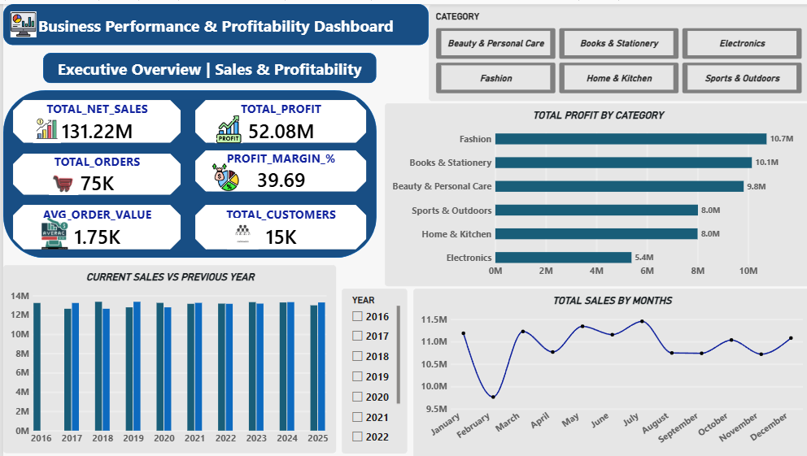
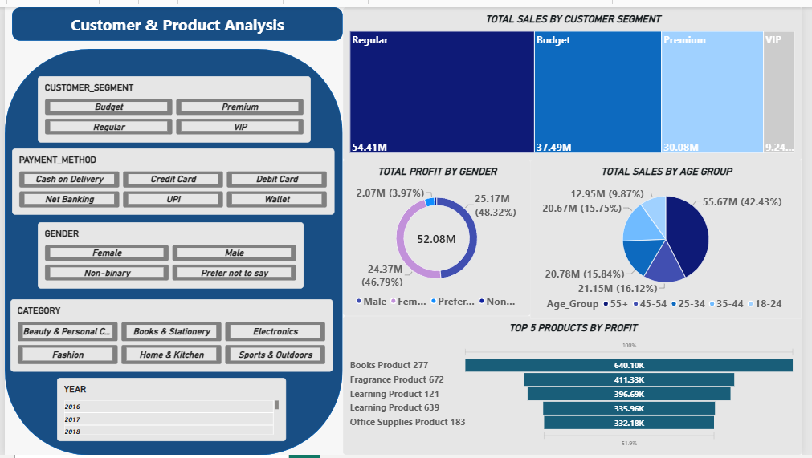

# Business Performance & Profitability Intelligence

### An End-to-End E-Commerce Data Engineering & Analytics Project

## Project One-Line Summary
An end-to-end data pipeline solution utilizing Snowflake for robust data warehousing and staging, optimized
SQL schemas for analytical calculations, and Power BI for executive-level dynamic tracking of $131.22M in
sales and $52.08M in corporate profits.

## Problem Statement
E-commerce businesses capture massive amounts of daily transactional data but often struggle to extract timely,
cross-functional insights. Without a unified dashboard, management faces difficulties in:
• Identifying which product categories drive the highest profit margins versus gross sales.
• Understanding customer demographic behaviors (age groups, gender splits, and regional spending habits).
• Tracking monthly sales trends and assessing annual performance patterns over time.

## Dataset Information & Architecture
The data architecture is structured as a robust Star Schema to optimize query performance and dashboard
responsiveness. It comprises 5 interconnected tables:
• fact_order_items: The core fact table containing metrics like ordered quantities, item-level prices, net sales, and
profit amounts.
• dim_customer: Detailed demographic profiles including Customer Segment (Regular, Budget, Premium, VIP),
Gender, and Age Group.
• dim_products: Product catalog information mapped by Category (Fashion, Electronics, Home & Kitchen, etc.)
and specific Product IDs.
• dim_order: Order details capturing payment methods (UPI, Credit/Debit Cards, Net Banking, Wallet) and
checkout flags.
• dim_date: Time-intelligence lookup containing full calendar dimensions (Year, Month, Quarter, Day) for trend
analysis.

## Tools and Technologies Applied
• Cloud Warehousing: Snowflake (Internal Staging, COPY INTO commands, File Formats, multi-cluster
Compute Pipelines).
• Database Engineering: Advanced SQL (Relational Schema Design, Window Functions, Complex Joins,
Common Table Expressions - CTEs).
• Data Visualization & Analytics: Power BI Desktop (Star Schema Modeling, Custom DAX Calculations,
Executive KPI Cards, Multi-Page Navigation).

## Methods & Pipeline Workflow
1. Cloud Data Ingestion: Processed operational records by hosting data landing zones inside Snowflake
Named Internal Stages (@ecommerce_stage).
2. Schema Engineering: Migrated raw unorganized values into a dedicated analytics platform built upon
decoupled Fact and Dimension schemas.
3. Analytical Operations: Engineered 5-8 complex production-ready SQL scripts utilizing partitions and CTEs
to safely deduce high-level performance numbers.
4. Data Model Connection: Established an optimized import layer linking Snowflake schemas securely into
the Power BI ecosystem.

## Executive Summary: Key Insights
• Core KPI Velocity: Safely monitored total operational footprints tracking $131.22M in Net Sales, $52.08M
in Total Profits, 75K Orders, and a stable 39.69% Profit Margin.
• Customer Segmentation: Mapped out high-value distribution lines showing Regular Customers
generating the largest volume at $54.41M, followed by Budget cohorts at $37.49M.
• Category Profit Performance: Isolated target sectors indicating Fashion as the top profit contributor at
$10.7M, closely trailed by Books & Stationery at $10.1M.
• Product Alpha Performance: Classified top-performing products confirming Books Product 277 leading all
item ranks with a staggering net profit of $640.10K.

## Dashboard / Model Output Preview
The Power BI executive framework contains highly advanced multi-page analytics:

• Page 1: Executive Overview: Tracks macro metrics, Current vs Previous Year comparisons, and Monthly
revenue patterns.

• Page 2: Customer & Product Analysis: Dynamic slice-and-dice panels filtering transactions by Gender,
Payment Methods, Age Groups, and high-margin product listings.

## How to Run This Project
1. Snowflake DDL Execution: Run the schema configuration queries found inside
1-Snowflake-Architecture/snowflake_setup.sql.
2. Database Pipeline Launch: Run the calculation logic scripts stored inside
2-SQL-Queries/business_questions.sql.
3. Power BI Report Inspection: Open the executive report file 
3-PowerBI-Dashboard/dashboard_visual.pbix inside Power BI Desktop to interact with live panels.

## Results & Conclusion
The dashboard successfully bridges raw e-commerce operations with administrative visualization. The high 39.69%
profit margin indicates solid overall health, but the sharp dependency on the 18-24 age group highlights areas where
targeted marketing could tap into older demographics. Furthermore, supply chain and marketing efforts should be
heavily aligned with mid-year surges to maximize seasonal revenue.

## Future Work & Scalability
• ELT Automation: Integrate automated orchestration using Apache Airflow or dbt to automate data
refreshes.
• Python Automation Pipeline: Build automated data ingestion scripts to pull data from production APIs
directly into Snowflake cloud storage.
• Predictive Analytics: Leverage Snowflake ML functions or Python forecasting models to predict product
inventory stockout thresholds.

## ## Author & Contact

*   *Name:* Shashank Mishra

*   *LinkedIn:* (http://linkedin.com/in/shashank-mishra-73b949237)

*   *GitHub:* (https://github.com/Shashank3451)
